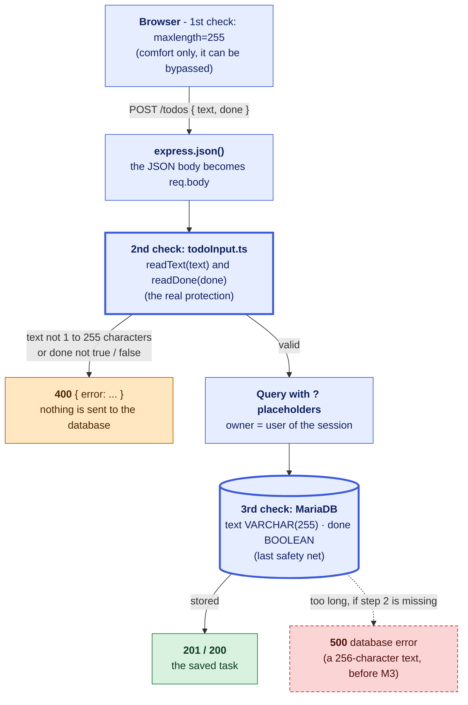

# ToDo List

A to-do list with sub-tasks, a Pomodoro focus timer and a weather widget.

- **Front end:** plain HTML / CSS / JavaScript in [public/](public/)
- **Back end:** Node.js + Express, written in TypeScript ([server.ts](server.ts))
- **Database:** MariaDB (tasks and sub-tasks)
- **Weather:** OpenWeatherMap API, called by the server so the API key never reaches the browser

## Quick start (everything already installed)

```bash
npm install
cp .env.example .env   # then fill in the values, see below
npm start
```

Open <http://localhost:3000>. You are sent to the login page first (see [Login](#login)). On Windows you can also double-click `todo.bat`, which opens the browser and starts the server.

## Configuration (`.env`)

| Variable          | Description                                   |
| ----------------- | --------------------------------------------- |
| `DB_HOST`         | MariaDB host, usually `localhost`             |
| `DB_USER`         | MariaDB user                                  |
| `DB_PASSWORD`     | Password of that user                         |
| `DB_NAME`         | Database name, `todo` by default              |
| `PORT`            | Port the server listens on, `3000` by default |
| `WEATHER_API_KEY` | Your OpenWeatherMap API key                   |

`.env` is ignored by git: never commit your passwords or API key.

## Scripts

| Command             | What it does                                                          |
| ------------------- | --------------------------------------------------------------------- |
| `npm start`         | Starts the server (Node runs `server.ts` directly by stripping types) |
| `npm run typecheck` | Checks the TypeScript types with `tsc` (nothing is compiled)          |
| `node --test`       | Runs the unit tests (`*.test.ts`, no database needed)                 |

## API

| Method   | Route                         | Body             | Description                     |
| -------- | ----------------------------- | ---------------- | ------------------------------- |
| `GET`    | `/todos`                      |                  | All tasks with their sub-tasks  |
| `POST`   | `/todos`                      | `{ text, done? }` | Create a task                   |
| `PATCH`  | `/todos/:id`                  | `{ done }`       | Mark a task done / not done     |
| `DELETE` | `/todos/:id`                  |                  | Delete a task and its sub-tasks |
| `POST`   | `/todos/:todoId/subtasks`     | `{ text }`       | Add a sub-task                  |
| `PATCH`  | `/todos/:todoId/subtasks/:id` | `{ done }`       | Mark a sub-task done / not done |
| `DELETE` | `/todos/:todoId/subtasks/:id` |                  | Delete a sub-task               |
| `GET`    | `/weather?city=Paris`         |                  | Current weather for a city      |

All the routes above need a login (`401` without one) and only ever see **the logged-in user's own tasks**: a task or sub-task of somebody else answers `404`, as if it did not exist. `POST /userlogin`, `POST /userregister` and `POST /userlogout` are described in the next section.

## Validation of the data

The server checks `text` and `done` **before any SQL runs** ([todoInput.ts](todoInput.ts), tested in [todoInput.test.ts](todoInput.test.ts)). The `maxlength` on the inputs only saves the user a round trip: it can be bypassed, so the check that counts is the one on the server. The database column is the last safety net.



| Field  | Rule                                                                                                                | Answer if wrong                                         |
| ------ | ------------------------------------------------------------------------------------------------------------------- | ------------------------------------------------------- |
| `text` | A string of 1 to 255 characters once the spaces around it are removed (an emoji counts as 1, like `VARCHAR(255)`). | `400` `{ "error": "text must have 1 to 255 characters" }` |
| `done` | A real JSON boolean, `true` or `false`. Not `"false"`, `0`, `1` or `null`.                                           | `400` `{ "error": "done must be true or false" }`       |

| Route                          | `text`   | `done`                       |
| ------------------------------ | -------- | ---------------------------- |
| `POST /todos`                  | required | optional (`false` if missing) |
| `PATCH /todos/:id`             |          | required                     |
| `POST /todos/:todoId/subtasks` | required |                              |
| `PATCH .../subtasks/:id`       |          | required                     |

Before this check, a text of 256 characters reached MariaDB, which refused it, and the server answered `500 database error`. Also, `"false"` sent as a string was stored as `true` (`Boolean("false")` is `true`), and a `PATCH` without `done` silently unticked the task.

## Login

The app asks for a login. [login.html](public/login.html) is a single form with two modes:

- **Login**: sends `username` and `password` to `POST /userlogin`.
- **Create Account** (the button under the form): the same form then asks for *pseudonyme*, *password* and *confirm password* and sends them to `POST /userregister`. The rules are in [register.ts](register.ts): pseudonyme of 3 to 50 characters, password of 8 to 72 characters, both passwords identical. The password is hashed with bcrypt and stored in `users.hashed_password`, and the new user is logged in at once. A pseudonyme that is already taken (it is `UNIQUE`, and MariaDB ignores the case) sends the form back with a message.

The **Log out** button of the app posts to `POST /userlogout`, which forgets the session, deletes the cookie and goes back to the login page.

When the values match, the server sets a session cookie (`HttpOnly`, `SameSite=Lax`, 8 hours) and sends the browser to the app. Without a session, `/` redirects to the login page and `/todos` and `/weather` answer `401`. Sessions are kept in memory: restarting the server logs everybody out.

The `hashed_password` column holds a **bcrypt hash**, never the password itself, and the password always travels in the request body, never in a URL. Anyone who can reach the server can create an account, and each account only sees its own tasks (see [Database and permissions](#database-and-permissions)).

To add a user by hand instead (as an admin), make the hash from the project folder (type the password, press Enter), then insert the row:

```bash
node -e "process.stdin.once('data', async d => { console.log(await (await import('bcrypt')).default.hash(d.toString().replace(/[\r\n]+/g, ''), 12)); process.exit(); })"
```

```sql
INSERT INTO todo.users (pseudonyme, hashed_password) VALUES ('alice', 'paste-the-hash-here');
```

## Database and permissions

The database and the `todos`, `subtask` and `users` tables are created by [schema.sql](schema.sql), and the app's user by [create_user.example.sql](create_user.example.sql) (copied to `create_user.local.sql`, which Git ignores, so the password stays out of the repository). Both are **run once by an admin**, see [step 6](#6-create-the-database-the-tables-and-the-apps-user-admin) below:

```bash
mariadb -u root -p < schema.sql
mariadb -u root -p < create_user.local.sql
```

The app connects as `todo_user`, which only has `SELECT`, `INSERT`, `UPDATE` and `DELETE` on the `todo` database (principle of least privilege). It cannot create, alter or drop tables, so the server never creates the schema itself: it only checks at startup that the tables exist.

The `users` table has one row per user (`user_id`, `pseudonyme`, `hashed_password`). `hashed_password` stores a bcrypt hash, never the password itself (see [Login](#login)).

Every task belongs to a user: `todos.parent_id` holds the `users.user_id` of its owner (foreign key, `ON DELETE CASCADE`). The server takes that id from the session, never from the browser, and every query on `todos` and `subtask` filters on it.

**Database created before the accounts existed?** `schema.sql` does not change tables that already exist, so an admin upgrades them once (replace `1` with the `user_id` that should own the existing tasks, see `SELECT user_id, pseudonyme FROM todo.users;`):

```sql
UPDATE todo.todos SET parent_id = 1 WHERE parent_id IS NULL OR parent_id = 0;
ALTER TABLE todo.todos
    MODIFY parent_id INT NOT NULL,
    ADD FOREIGN KEY (parent_id) REFERENCES todo.users (user_id) ON DELETE CASCADE;
ALTER TABLE todo.users
    MODIFY pseudonyme VARCHAR(50) NOT NULL,
    MODIFY hashed_password VARCHAR(255) NOT NULL,
    ADD UNIQUE (pseudonyme);
```

---

## How to start the project from scratch

This section assumes a fresh Windows computer with **nothing** installed. (On macOS / Linux the steps are the same, only the install commands differ.)

### 1. Install Git

Download and install Git from <https://git-scm.com/downloads> (default options are fine). Check it works in a new terminal:

```bash
git --version
```

### 2. Install Node.js

The server is written in TypeScript and Node runs it **directly**, so you need **Node.js 22.18 or newer** (the current LTS is fine).

Download the LTS installer from <https://nodejs.org> and install it. `npm` comes with it. Check:

```bash
node -v
npm -v
```

### 3. Install MariaDB

Download MariaDB Server from <https://mariadb.org/download/> and run the installer.

- When asked, **choose a password for the `root` user** and write it down.
- Keep the default port `3306`.
- Leave "Install as service" checked so MariaDB starts with Windows.

Alternatively, from a terminal: `winget install MariaDB.Server`.

### 4. Get a weather API key

1. Create a free account on <https://openweathermap.org>.
2. Go to **My API keys** and copy your key.

A new key can take a little while (up to a couple of hours) before it works. The rest of the app works without it.

### 5. Get the code

```bash
git clone <url-of-this-repository> ToDoList
cd ToDoList
```

### 6. Create the database, the tables and the app's user (admin)

This step is done **as the MariaDB admin (`root`)**, with two files:

- [schema.sql](schema.sql) creates the database and the tables. It holds no password: run it as it is.
- [create_user.example.sql](create_user.example.sql) creates the app's user `todo_user`. It is a template: the copy you edit, `create_user.local.sql`, is ignored by Git, so your password is never committed.

1. Copy the template, then open the copy and replace `'change_me'` with a real password. You will put the same one in `.env` (step 8):

   ```bash
   cp create_user.example.sql create_user.local.sql        # Git Bash / macOS / Linux
   copy create_user.example.sql create_user.local.sql      # Windows cmd / PowerShell
   ```

2. Run both files from the project folder, in this order, and enter the root password each time:

   ```bash
   mariadb -u root -p < schema.sql
   mariadb -u root -p < create_user.local.sql
   ```

   In PowerShell, `<` does not work, use: `Get-Content schema.sql | mariadb -u root -p` (and the same with `create_user.local.sql`).
   If `mariadb` is not found, open the **MySQL Client (MariaDB)** shortcut from the Start menu and type `source C:/path/to/ToDoList/schema.sql` then `source C:/path/to/ToDoList/create_user.local.sql`.

3. Check the user's rights:

   ```sql
   SHOW GRANTS FOR 'todo_user'@'localhost';
   ```

   You should only see `GRANT SELECT, INSERT, UPDATE, DELETE ON todo.* ...` (plus the `USAGE` line, which means "can log in").

To change the password later, edit `create_user.local.sql`, run it again, and update `DB_PASSWORD` in `.env`.

### 7. Install the dependencies

```bash
npm install
```

This creates `node_modules/` with Express, the MariaDB driver, dotenv and TypeScript.

### 8. Create the `.env` file

Copy the example file:

```bash
cp .env.example .env        # Git Bash / macOS / Linux
copy .env.example .env      # Windows cmd / PowerShell
```

Then edit `.env` with the values from steps 4 and 6:

```env
DB_HOST=localhost
DB_USER=todo_user
DB_PASSWORD=the_password_you_put_in_create_user.local.sql
DB_NAME=todo
PORT=3000
WEATHER_API_KEY=your_openweathermap_key
```

### 9. Start the server

```bash
npm start
```

You should see:

```
ToDo List running on http://localhost:3000
```

Open <http://localhost:3000> in your browser, click **Create Account** to make your first user, and you are in. Done!

### Troubleshooting

| Problem                                        | Fix                                                                                      |
| ---------------------------------------------- | ---------------------------------------------------------------------------------------- |
| `Could not connect to MariaDB: ...`            | Check MariaDB is running (Windows _Services_ → MariaDB) and the `DB_*` values in `.env`. |
| `Access denied for user`                       | Wrong `DB_USER` / `DB_PASSWORD` in `.env`, or `create_user.local.sql` was not run (step 6). |
| `Unknown database 'todo'` / `Table ... doesn't exist` | An admin must run `schema.sql` (step 6).                                          |
| `... command denied to user 'todo_user'`       | Expected for anything other than SELECT/INSERT/UPDATE/DELETE: do it as root.             |
| Logged in but the task list is empty           | Tasks are per user: older tasks have no owner yet, see the upgrade SQL in the Database section. |
| `SyntaxError` / `Unknown file extension ".ts"` | Your Node.js is too old: install 22.18 or newer (step 2).                                |
| `EADDRINUSE`                                   | Port 3000 is already used: stop the other program or change `PORT` in `.env`.            |
| Weather shows an error / `401`                 | API key missing, wrong, or not activated yet (step 4).                                   |
| Login always says "Wrong pseudonyme or password" | The `hashed_password` column must be a bcrypt hash and the pseudonyme must match (Login). |
| Sent back to the login page by itself          | Normal after a server restart or 8 hours: sessions are kept in memory.                   |
